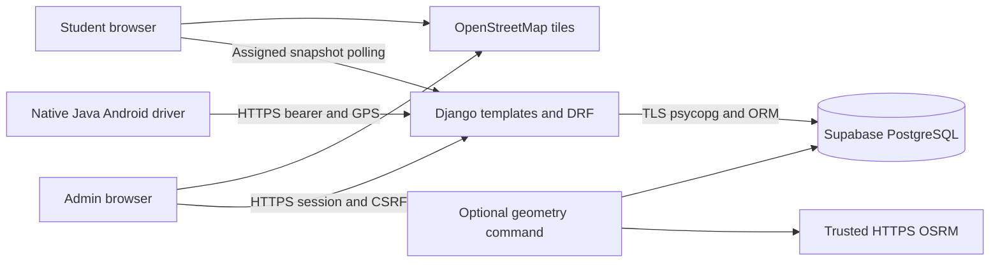

# Architecture

One Django server and PostgreSQL are sufficient for a small college. No distributed message broker or background worker is required.

`accounts` owns email/password authentication, ADMIN/STUDENT/DRIVER roles and 12-hour hashed bearer tokens. Browsers use secure sessions and CSRF. Native tokens are encrypted with Android Keystore; database credentials remain on the Django host.

`admin_portal.services` validates assignments under transaction/advisory/bus locks. A student has one active bus; a bus has one active driver/route. Pickup stops must belong to that active route. Deactivation and route changes protect active trips and affected students. Service validation supplements database foreign keys and partial unique constraints.

`students.queries.dashboard_snapshot` derives the assignment from `request.user`, materializes it transactionally and uses fixed student URLs. Bus ID parameters never authorize a location read. General bus/trip APIs scope querysets by role. Driver mutations lock and recheck the current active assignment and owned trip.

GPS ingestion validates timestamps, finite ranges and plausible displacement, then atomically updates latest position, optional history and route progress. Identical retries are idempotent; older samples cannot overwrite newer ones. Completed trips reject further writes. Both recorded and received timestamps participate in freshness.

The GIS module projects locations onto directional GeoJSON using metre distances. Progress is monotone within a trip. ETA combines route distance, smoothed speed or a labelled configured fallback, and dwell assumptions. It is not traffic-aware. Invalid/missing geometry, stale GPS, off-route, direction mismatch, stationary and passed pickup states return unavailable.

Leaflet initializes once and updates markers. Configurable polling defaults to 10 seconds, avoids overlapping fetches and cleans up on exit. Android retains only the newest pending sample in memory and uses bounded backoff. Process recreation never silently resumes sharing.

Production uses WhiteNoise, Waitress behind a TLS proxy and a local file cache for login budgets. Cache counters are approximate under concurrency; configure proxy rate limiting. Multiple application hosts would require a shared throttle store, outside the current single-host design.

Development replay requires DEBUG plus explicit enablement and visibly marks simulations. Production disables it. QA scripts use disposable local PostgreSQL and synthetic coordinates. They cannot prove real satellite reception or production Supabase GPS flow.
